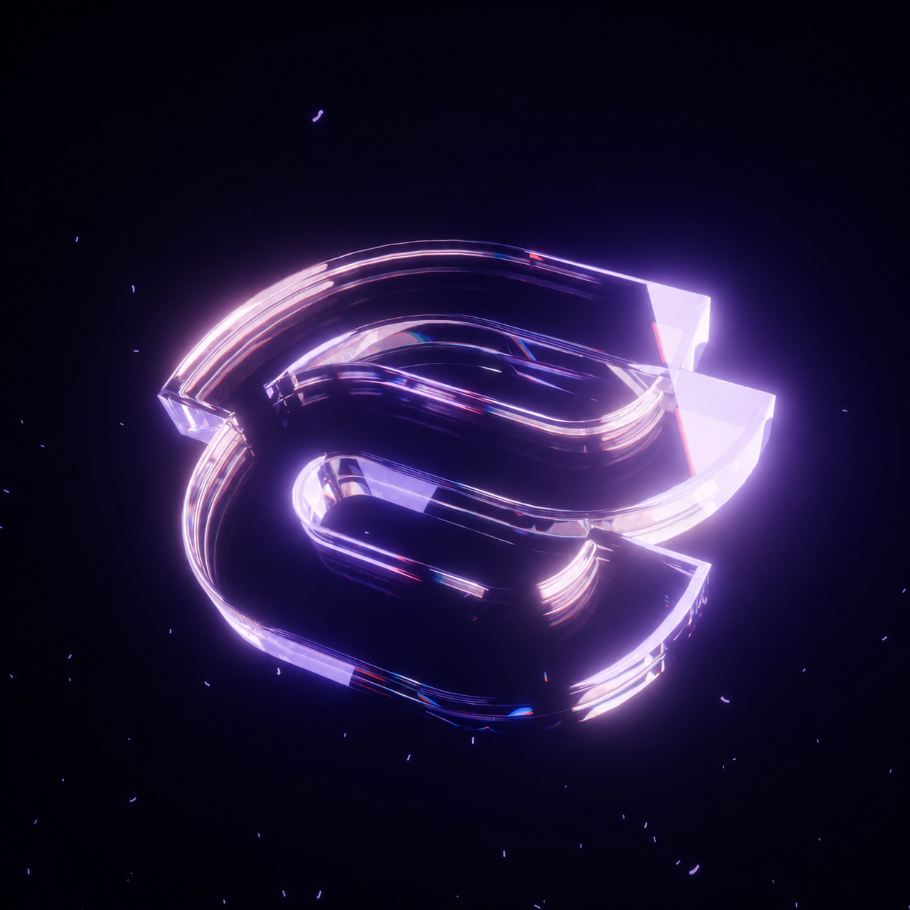

<div align="center">



# EnoughVisuals

Визуальный клиент для Minecraft **1.21.4** на Fabric: кастомный интерфейс, HUD, шейдерные эффекты, косметика и удобные утилиты для PvP-серверов.


[Telegram](https://t.me/enoughvisuals) · [Changelog](CHANGELOG.md)

</div>

## Возможности

- **Интерфейс** — собственные ClickGUI, главное меню, экраны паузы и настроек, менеджер аккаунтов, выбор языка (RU / UK / EN). Текст рисуется MSDF-шрифтом Inter, иконки — набор Solar.
- **HUD** — Watermark, Target HUD, эффекты, кулдауны, бинды, броня, инвентарь, кастомный хотбар, медиаплеер и уведомления. Все элементы перетаскиваются по сетке.
- **Визуал** — GlowESP, TargetESP, Trails, Particles, Jump Circle, China Hat, Kill / Attack Effect, Motion Blur, ColorPlus, Atmosphere, Shader Sky, Item Physics, Prediction и ещё около 40 модулей.
- **Косметика** — каталог моделей с предпросмотром, питомцы, колесо эмоций с анимациями персонажа и граффити.
- **WebPanels** — браузерные панели в мире (MCEF/CEF) с пространственным звуком.
- **Утилиты** — макросы, GPS, друзья, конфиги, Auto Potion / Eat / Swap, Fast XP, Item Scroller, Streamer Mode и другие.
- **Совместимость с серверами** — модули, запрещённые на конкретном сервере (HolyWorld, ReallyWorld и др.), отключаются автоматически, в том числе через HolyWorld LiteAPI.

## Установка

1. Установите [Fabric Loader](https://fabricmc.net/use/) 0.18.4+ для Minecraft 1.21.4.
2. Положите в папку `mods` [Fabric API](https://modrinth.com/mod/fabric-api) и jar EnoughVisuals.
3. Запустите игру. ClickGUI открывается на **Right Shift**.

Косметика, MCEF и Pulse-рантайм уже вложены в jar — ставить их отдельно не нужно.

## Сборка

Нужен **JDK 21**. Сборка сейчас рассчитана на Windows.

```bash
./gradlew runClient      # запуск клиента в dev-окружении
./gradlew remapJar       # обычный jar: build/libs/enoughvisuals-<версия>.jar
./gradlew build          # jar + защищённая сборка через EnoughGuard
./gradlew test           # юнит-тесты
```

Перед первой сборкой проверьте локальные пути:

| Что | Где задаётся |
| --- | --- |
| JDK для Gradle | `org.gradle.java.home` в `~/.gradle/gradle.properties` |
| Обфускатор EnoughGuard (только для `build`) | `enoughGuardRoot` в `~/.gradle/gradle.properties` или переменная `ENOUGH_GUARD_ROOT` |
| Исходный jar Punchy 2.6.2 | `punchySourceJar` в `~/.gradle/gradle.properties` или переменная `PUNCHY_SOURCE_JAR` |

Версия мода берётся из `Info.VERSION` (`src/main/java/fun/enoughvisuals/Info.java`).

## Структура проекта

```
src/main/java/fun/enoughvisuals/
├── systems/      модули, настройки, конфиги, HUD, сеть, косметика, эмоции
├── ui/           ClickGUI, главное меню, экраны, HUD-элементы
├── utils/        рендер (шейдеры, блюр, шрифты), звук, игрок, система
├── mixins/       миксины Minecraft
└── port/         портированные эффекты и рендереры
src/main/java/punchy/        встроенный Punchy (анимации)
src/main/java/fun/wounsee/   мост косметики
cosmetic-build/              вложенная сборка cosmetic-мода
scripts/                     генерация шрифтовых атласов и иконок, тестовые скрипты
native/cef-audio/            нативный мост звука CEF
libs/                        локальные зависимости (MCEF, Pulse, FTE API)
```

### Добавление модуля

1. Создайте класс в `systems/modules/modules/<category>/`, наследуйте `Module` и повесьте `@Register(name, id, description, category)`.
2. Зарегистрируйте его в `EnoughCore.initializeClient()` через `ModuleManager.register(...)`.
3. Добавьте строки перевода в `assets/enough/lang/*.json`.

### Шрифты и иконки

Атласы MSDF генерируются Python-скриптами из `scripts/font-assets` (зависимости — в `requirements.txt`). Проверка атласов входит в `./gradlew check`:

```bash
./gradlew auditFontAssets
```

## Лицензия

См. [LICENSE.txt](LICENSE.txt). Сторонние компоненты (Solar Icons, FunTimeEventsSDK, MCEF, Punchy) распространяются на условиях своих лицензий.
