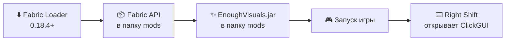
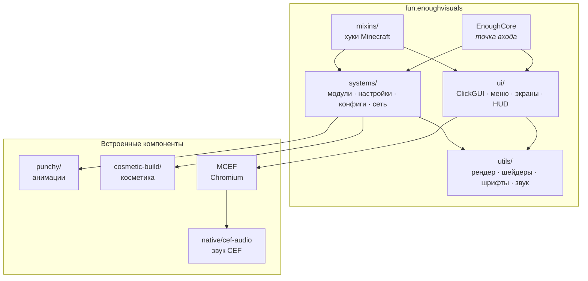

<div align="center">


<a href="https://t.me/enoughvisuals">
  
</a>

<br>


<a href="https://t.me/enoughvisuals"></a>
<a href="https://dsc.gg/enoughvisuals"></a>
<a href="CHANGELOG.md"></a>


**[Возможности](#-возможности)** ·
**[Модули](#-модули)** ·
**[Установка](#-установка)** ·
**[Сборка](#%EF%B8%8F-сборка)** ·
**[Архитектура](#-архитектура)** ·
**[Разработка](#-разработка)**

</div>

---

## ✨ Возможности

<table>
<tr>
<td width="50%" valign="top">

### 🖥️ Интерфейс
Собственный **ClickGUI**, главное меню с анимациями, экраны паузы и настроек, менеджер аккаунтов с избранным и выбор языка с живыми флагами.
Текст — MSDF-шрифт **Inter**, иконки — набор **Solar**.

</td>
<td width="50%" valign="top">

### 📊 HUD
Watermark, Target HUD, эффекты, кулдауны, бинды, броня, инвентарь, кастомный хотбар, медиаплеер и уведомления.
Каждый элемент **перетаскивается по сетке**.

</td>
</tr>
<tr>
<td valign="top">

### 🎨 Визуал
GlowESP, TargetESP, Trails, Particles, Jump Circle, China Hat, Kill / Attack Effect, Motion Blur, ColorPlus, Shader Sky, Item Physics, Prediction — **46 визуальных модулей**.

</td>
<td valign="top">

### 🧢 Косметика и эмоции
Каталог моделей с 3D-предпросмотром, питомцы, **колесо эмоций** со скелетной анимацией персонажа и граффити.

</td>
</tr>
<tr>
<td valign="top">

### 🌐 WebPanels
Браузерные панели прямо в мире на базе **MCEF / Chromium**: вкладки, изогнутые экраны, синхронизация между игроками и **пространственный звук**.

</td>
<td valign="top">

### 🛡️ Совместимость с серверами
Модули, запрещённые на конкретном сервере (HolyWorld, ReallyWorld и др.), **отключаются автоматически** — в том числе через HolyWorld LiteAPI.

</td>
</tr>
</table>

## 🧩 Модули

> Нажмите на категорию, чтобы раскрыть список.

<details>
<summary><b>🎨 Visual</b> — 46 модулей</summary>
<br>

`Ambience` `Animations` `AspectRatio` `AtmoDawnFog` `AttackEffect` `BetterHands` `BlockOverlay` `ChinaHat` `ColorPlus` `Cooldowns` `Crosshair` `CustomHitbox` `FreeLook` `FriendMarker` `Fullbright` `GlowESP` `HealthIndicator` `HitColor` `HitParticles` `HitRange` `ItemLight` `ItemPhysics` `JumpCircle` `JumpCube` `JumpEffect` `KillEffect` `MaceIndicator` `MotionBlur` `MouseParticles` `NoFluid` `NoRender` `Particles` `Prediction` `ShaderHands` `ShulkerPreview` `SkyBox` … и другие

</details>

<details>
<summary><b>🛠️ Utils</b> — 38 модулей</summary>
<br>

`AutoAccept` `AutoEat` `AutoNear` `AutoPotion` `AutoReconnect` `AutoResell` `AutoRespawn` `AutoSprint` `ChatHelper` `ClickFriend` `ClickPearl` `CustomSphereSkin` `DeathCords` `ElytraUtility` `FTHelper` `FakePlayer` `FastSearch` `FastSwap` `FastXP` `HealingHelper` `HitSound` `ItemPickupLogger` `ItemScroller` `ItemSwap` `KillSound` `LockSlot` `LowArmorNotify` `Macros` `NameProtect` `Optimization` `PvPSave` `SendCord` … и другие

</details>

<details>
<summary><b>⚙️ Client</b> — 9 модулей</summary>
<br>

`Configs` `CustomTheme` `Emotions` `Friends` `GPS` `Globals` `Graffiti` `GuiSize` `HUD`

</details>

## 📥 Установка



1. Установите [Fabric Loader](https://fabricmc.net/use/) **0.18.4+** для Minecraft **1.21.4**.
2. Положите в папку `mods` [Fabric API](https://modrinth.com/mod/fabric-api) и jar EnoughVisuals.
3. Запустите игру — ClickGUI открывается на **Right Shift**.

> [!TIP]
> Косметика, MCEF и Pulse-рантайм уже вложены в jar — ставить их отдельно не нужно.

## 🛠️ Сборка

Нужен **JDK 21**. Сборка рассчитана на Windows.

```bash
./gradlew runClient      # клиент в dev-окружении
./gradlew remapJar       # jar: build/libs/enoughvisuals-<версия>.jar
./gradlew build          # jar + защищённая сборка через EnoughGuard
./gradlew test           # юнит-тесты
```

<details>
<summary><b>🔧 Локальные пути и секреты</b> — не коммитьте их в репозиторий</summary>
<br>

Все машинно-зависимые настройки задаются в **`~/.gradle/gradle.properties`** или через переменные окружения:

| Параметр | Свойство Gradle | Переменная окружения | По умолчанию |
| --- | --- | --- | --- |
| JDK для Gradle | `org.gradle.java.home` | `JAVA_HOME` | системный JDK |
| Исходный jar Punchy 2.6.2 | `punchySourceJar` | `PUNCHY_SOURCE_JAR` | `libs/punchy-2.6.2-fabric-1.21.5.jar` |
| Обфускатор EnoughGuard (только `build`) | `enoughGuardRoot` | `ENOUGH_GUARD_ROOT` | `../EnoughGuard/obfuscator` |
| Ключ FunTime Events (только dev) | `-Denoughvisuals.funtimeEvents.apiKey` | `ENOUGH_FUNTIME_EVENTS_API_KEY` | — |
| Генератор MSDF-атласов | — | `MSDF_ATLAS_GEN` | `msdf-atlas-gen` из `PATH` |

Пример `~/.gradle/gradle.properties`:

```properties
org.gradle.java.home=C:/Users/you/.jdks/corretto-21
punchySourceJar=C:/Users/you/Downloads/punchy-2.6.2-fabric-1.21.5.jar
enoughGuardRoot=C:/Users/you/EnoughGuard/obfuscator
```

Для `runClient` ключ FunTime Events можно положить в `run/enoughvisuals-dev.properties` (`funtime.events.api-key=...`) — файл игнорируется git.

</details>

Версия мода берётся из `Info.VERSION` в [`Info.java`](src/main/java/fun/enoughvisuals/Info.java).

## 🏗️ Архитектура



<details>
<summary><b>📁 Структура репозитория</b></summary>

```
src/main/java/fun/enoughvisuals/
├── systems/      модули, настройки, конфиги, HUD, сеть, косметика, эмоции
├── ui/           ClickGUI, главное меню, экраны, HUD-элементы
├── utils/        рендер (шейдеры, блюр, шрифты), звук, игрок, система
├── mixins/       миксины Minecraft
└── port/         портированные эффекты и рендереры
src/main/java/punchy/        встроенный Punchy (анимации)
src/main/java/fun/wounsee/   мост косметики
cosmetic-build/              вложенная сборка cosmetic-мода
scripts/                     шрифтовые атласы, иконки, тестовые скрипты
native/cef-audio/            нативный мост звука CEF
libs/                        локальные зависимости (MCEF, Pulse, FTE API)
```

</details>

## 👩‍💻 Разработка

<details>
<summary><b>➕ Добавление модуля</b></summary>
<br>

1. Создайте класс в `systems/modules/modules/<category>/`, наследуйте `Module` и повесьте `@Register(name, id, description, category)`.
2. Зарегистрируйте его в `EnoughCore.initializeClient()` через `ModuleManager.register(...)`.
3. Добавьте строки перевода в `assets/enough/lang/*.json` (RU / UK / EN).

```java
@Register(name = "MyModule", id = "my_module", description = "...", category = Category.VISUAL)
public final class MyModule extends Module {
    // ...
}
```

</details>

<details>
<summary><b>🔤 Шрифты и иконки</b></summary>
<br>

MSDF-атласы генерируются Python-скриптами из `scripts/font-assets` (зависимости — в `requirements.txt`). Проверка атласов входит в `./gradlew check`:

```bash
./gradlew auditFontAssets
```

</details>

## 📜 Лицензия

См. [LICENSE.txt](LICENSE.txt). Сторонние компоненты (Solar Icons, FunTimeEventsSDK, MCEF, Punchy) распространяются на условиях своих лицензий.

<div align="center">

<br>

**Сделано с 💜 командой EnoughVisuals** · [t.me/enoughvisuals](https://t.me/enoughvisuals)


</div>
